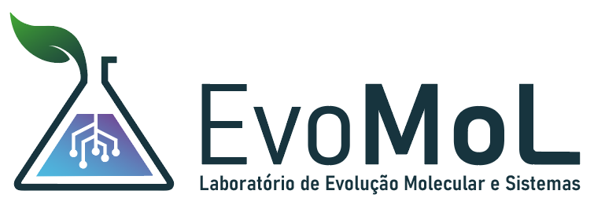

# Sauron — Residue Interaction Network Calculator: Full Documentation

## Table of Contents
1. [Overview](#overview)
2. [Installation](#installation)
3. [Command-Line Interface (`sauron.py`)](#command-line-interface-sauronpy)
4. [Interaction Types and Geometric Definitions](#interaction-types-and-geometric-definitions)
5. [Output Files](#output-files)
6. [Web Interface (`SauronGUI.py`)](#web-interface-sauronguipy)
7. [Comparisons Against other tools](#comparisons-against-other-tools)
8. [Known Limitations](#known-limitations)
9. [Container Deployment](#container-deployment)
10. [Third-Party Libraries](#third-party-libraries)
11. [License](#license)
12. [Artificial Intelligence Disclosure](#artificial-intelligence-disclosure)
13. [Citing Sauron](#citing-sauron)
14. [Credits](#credits)

---

## Overview

**Sauron** parses a protein structure file (PDB or PDBx/mmCIF, single-model or
multi-model/NMR ensembles) and computes a **Residue Interaction Network (RIN)**: a
graph where nodes are residues and edges are typed, geometrically-defined
non-covalent (and covalent, for disulfides) contacts between them — hydrogen bonds,
van der Waals contacts, salt bridges, π-stacking, cation-π, metal coordination,
halogen bonds, π-hydrogen bonds, and (optionally) water-mediated bridges.

Its outputs are designed to be compatible with the [RING](https://ring.biocomputingup.it/) tool (Del Conte et al., *NAR*
2024) — see [Comparisons Against other tools](#comparisons-against-other-tools). Sauron is not a
reimplementation of RING's (closed-source) engine, and it is not supposed to produce the same results as RING. It independently computes the
same interaction *types* from documented geometric criteria and published
literature, using available Python packages (e.g. ProDy, RinPy, and NetworkX, etc.).

Sauron has two front ends built on the same [`sauron.py`](sauron.py) calculation
engine:
- **`sauron.py`** — a command-line tool for batch/scripted use.
- **`SauronGUI.py`** — a local Flask web application (`templates/index.html`,
  `static/script.js`) that wraps the same engine with a 3D structure viewer, an
  interactive network graph, and summary tables/charts.

---

## Installation

Requires **Python ≥ 3.12**.

```bash
pip install -r requirements.txt
# or, with uv (the project also ships a pyproject.toml):
uv sync
```

`pdb2pqr` (used by `--add-h` and `--energy`) is installed as a Python dependency and
invoked as a subprocess; no separate system install is needed. See
[Container Deployment](#container-deployment) for a dependency-free alternative.

---

## Command-Line Interface (`sauron.py`)

```bash
python sauron.py <input_file> [options]
```

`<input_file>` is a `.pdb` or `.cif`/`.mmcif` file. Multi-model files (e.g. NMR
ensembles) are processed model by model; see [Output Files](#output-files).

### Options

| Flag | Description |
|---|---|
| `--calc-method {sauron,insty,rinpy}` | Interaction-calculation methodology. Default: `sauron`. See below. `standard`, the method's former name, is still accepted as an alias. |
| `--add-h` / `--no-add-h` | **On by default** (matching the GUI, which always adds hydrogens); disable with `--no-add-h`. Add explicit hydrogens with `pdb2pqr` (force field `PARSE`) before computing interactions. No-op (with a fallback warning) if `pdb2pqr` is unavailable. Strongly recommended for `--calc-method insty`, and required for `--strict-angle` / `--energy` to have any effect on a structure that doesn't already carry hydrogens (e.g. most X-ray depositions; NMR ensembles usually already have them). |
| `--strict-angle` / `--no-strict-angle` | **On by default** (matching the GUI); disable with `--no-strict-angle`. Uses explicit hydrogens (native or added via `--add-h`) to check hydrogen-bond geometry: `HBOND` needs a donor–H···acceptor angle > 120°, measured on the **donor's own** hydrogens, and `PIHBOND` needs the donor's hydrogen to point at the ring (see the table below). When disabled, `HBOND` uses a fixed placeholder `Angle` of `150.000` and both types are accepted on distance alone. If no hydrogens are present at all, every `HBOND` candidate is rejected — use `--add-h` on H-less inputs, or pass `--no-strict-angle`. |
| `--remove-multiples` / `--no-remove-multiples` | **On by default** (matching the GUI); disable with `--no-remove-multiples`. Collapse duplicate edges of the *same type* between the same residue pair down to the single shortest-distance one. Multiple edges of *different* types on the same pair (e.g. an `HBOND` and a separate `VDW` contact) are unaffected. |
| `--chains A,B,C` | Restrict the calculation to the given chain(s) (comma-separated, case-sensitive to match the file). Default: all chains. |
| `--energy` | Residue–residue interaction energy (`Energy` column, kcal/mol) on every edge, **summed over all atom pairs of the two residues**: Coulomb with a distance-dependent dielectric, `332.0637·Σ q_i·q_j/(4·r_ij²)`, using the partial charges of a PQR file (pdb2pqr, PARSE force field). All edges between the same two residues carry the same value. Requires `--add-h` (the default) or a PQR input; with neither, Sauron warns and `Energy` stays `nan`. `nan` also for residues without charges (ligands pdb2pqr cannot parameterize), for residues fewer than 3 apart along the chain (bonded terms are not modelled) and for `WATERBRIDGE` edges (water-mediated, not a direct interaction). Atom pairs within three bonds across a covalent link (e.g. a disulfide) are excluded, as in force fields. |
| `--vdw-energy` | With `--energy`, also add a generic 12-6 Lennard-Jones term, `ε·Σ[(r_min/r)¹² − 2(r_min/r)⁶]` with a uniform `ε = 0.1` kcal/mol and `r_min` = sum of the two Bondi radii. Polar hydrogens carry no LJ term, as in the AMBER and CHARMM force fields. It is a qualitative term, not a force-field energy. No effect without `--energy`. |
| `--vdw-contacts {close,wide}` | Which van der Waals contact classes (Word et al. 1999, MolProbity) count as `VDW` edges. `close` (default): vdW surfaces at most 0.25 Å apart, or overlapping by less than 0.4 Å. `wide`: also accepts surfaces 0.25–0.5 Å apart. Overlaps of 0.4 Å or more are steric clashes in both modes. Recorded in `<prefix>_sauron.log`. |
| `--water-bridges` | Detect `WATERBRIDGE` edges (see below). Off by default. With `--calc-method insty`, ProDy's own water-bridge detection is used instead. A Sauron-specific extension. |

### `--calc-method` choices

- **`sauron`** (default) — Sauron's own distance/angle/role-based geometric
  engine; see [Interaction Types and Geometric Definitions](#interaction-types-and-geometric-definitions).
  Every threshold is defined a priori from the literature (references in the table).
  Formerly called `standard`; the old name is still accepted.
- A **Voronoi** method (`voronoi`) existed in earlier versions. It was removed
  because, with Sauron's distance criteria, its networks were a strict subset of
  the `sauron` method's (residue-pair Jaccard ≥ 0.98 on 64 structures, no pair
  found only by Voronoi).
- **`insty`** — Delegates interaction detection to
  [ProDy](http://www.bahargroup.org/prody/)'s `calcProteinInteractions` /
  `calcWaterBridges`, which independently implements a similar interaction
  taxonomy (HBOND, IONIC/salt bridges, PIPISTACK, PICATION, VDW/hydrophobic,
  SSBOND, WATERBRIDGE). Requires a structure with explicit hydrogens (use
  `--add-h`). ProDy receives the structure Sauron already parsed, with residues
  renumbered 1..N per chain (ProDy's selections break on negative numbers and
  insertion codes), and every result is mapped back to the original residue ids.
  Falls back to `sauron` if ProDy fails. These edges follow ProDy's own
  criteria, not the table below; `Energy` (with `--energy`) and the clash list
  are computed by Sauron as for the other methods.
- **`rinpy`** — Runs the [RinPy](https://pypi.org/project/rinpy/) package instead
  of Sauron's own typed-edge engine. RinPy builds a **residue-affinity network**
  from an Elastic Network Model (not RING-style typed contacts) and computes
  degree/betweenness/closeness centrality plus hinge-residue detection via
  Laplacian normal-mode analysis. Output is written under
  `<prefix>_rinpy_out/`, and a `<prefix>_rinpy_summary.json` (top-10 residues per
  centrality measure, hinge residues per mode) is produced for the GUI. This mode
  does **not** produce `.edges`/`.nodes`/network-metrics files.

### Examples

```bash
# Default RIN (hydrogen addition, strict H-bond geometry and one edge per type per residue pair are on by default)
python sauron.py 1AFW.pdb

# Legacy behaviour: no added hydrogens, distance-only H-bonds, keep duplicate edges
python sauron.py 1AFW.pdb --no-add-h --no-strict-angle --no-remove-multiples

# Compute electrostatic + VDW energy per edge (hydrogens are added by default), chains A and B only
python sauron.py 1AFW.pdb --energy --vdw-energy --chains A,B

# Include Sauron's water-bridge extension
python sauron.py 4AKE.cif --water-bridges

# Elastic Network Model / hinge analysis via RinPy
python sauron.py 4AKE.cif --calc-method rinpy
```

---

## Interaction Types and Geometric Definitions

All distance thresholds below apply to the **`sauron`** engine
(`calculate_rin()` in [sauron.py](sauron.py)). Candidate atom pairs are first
gathered with a 6.5 Å neighbor search (the widest of all thresholds below), then
grouped by residue pair. **Residue pairs on the same chain closer than 3 apart in
sequence are excluded outright** (`|i − j| < 3`): the fixed peptide-bond geometry
alone puts adjacent residues' backbone atoms well inside every threshold below
(e.g. `O(i)···N(i+1)` sits at ≈2.2 Å), which would otherwise be misreported as a
genuine interaction on *every* residue in every chain. Sequence separation is
measured along the **covalent chain**, not by residue number: peptide bonds
(`C(i)–N(i+1)` ≤ 2.0 Å, or `O3′–P` for nucleic acids) are detected geometrically,
independent of file order, and each chain is split into connected segments
wherever that bond is missing. Inside a segment, separation is the number of
links between the two residues, so numbering that skips
(e.g. `99 → 102`, or a propeptide `62P → 1`) or repeats with insertion codes
(`0, 0A, 0B, …`) no longer turns a peptide bond into a `VDW:MC_MC` edge, nor
hides real contacts between distant residues that share a number. Across a chain
break, the residue-number difference is used (it is the only estimate of how many
residues are missing). Ligands and ions that are not covalently linked to the
chain are never excluded by this rule.

Each type below is evaluated **independently** — a residue pair can (and often
does) carry edges of several different types simultaneously (e.g. a backbone
`HBOND` and a side-chain `PICATION` on the same pair). Per residue pair, most
types report at most one edge (`SSBOND`, `IONIC`, `PIPISTACK`, `PICATION`,
`METAL`, `HALOGEN`, `PIHBOND`, and the `VDW` fallback described below all keep
only their single best/first-qualifying atom pair); `HBOND` and `WATERBRIDGE` are
the exceptions and can report one edge per qualifying atom pair (e.g. two
side-chain acceptors each hydrogen-bonding to the same donor produce two `HBOND`
rows) — `--remove-multiples` (on by default) collapses those down to one per type per pair.

| Type | Criterion | Notes |
|---|---|---|
| **SSBOND** | `SG···SG` distance ≤ 2.5 Å between two `CYS` residues. | Supersedes all other checks for that pair (a disulfide-bonded pair gets nothing else). |
| **IONIC** | Distance ≤ 4.0 Å between a cation's charge-bearing point and an anion's charge centroid. Cation point: `ARG:CZ` (centre of the guanidinium group) or `LYS:NZ`. Anion centroid: mean of `ASP:{OD1,OD2}` or `GLU:{OE1,OE2}`. | Salt-bridge distance of Barlow & Thornton (1983) and Kumar & Nussinov (2002). `HIS` is **not** treated as a cation, since its protonation state depends on the environment. |
| **PIPISTACK** | Ring-centroid-to-ring-centroid distance ≤ 6.5 Å between two aromatic residues (`PHE`, `TYR`, `TRP`, `HIS`). | Aromatic–aromatic pair within the centroid range of Burley & Petsko (1985). No ring-offset criterion is applied, so this is an aromatic-pair proximity rather than strict face-to-face stacking. `Orientation` is `P` (normals ≤ 45° apart) or `T` otherwise, from ring plane normals fitted by SVD. |
| **PICATION** | Distance ≤ 5.0 Å between an aromatic ring centroid and a cation point (same `CZ`/`NZ` convention as `IONIC`), **and** the angle between the cation vector and the ring's plane normal is ≤ 45° (0° = cation directly above the ring face). | Cation–π geometry: the cation must sit over the ring face, not in the ring plane (Gallivan & Dougherty 1999). |
| **METAL** | Distance ≤ a per-element coordination cutoff between a recognized metal atom and an `N`/`O`/`S` atom. Cutoffs (Å): Na 3.0, K 3.4, Mg 2.6, Ca 3.2, Mn 2.7, Fe 2.7, Co 2.6, Ni 2.5, Cu 2.6, Zn 2.7, Cd 2.9, Hg 3.0, Li 2.6, Cs 3.6; unlisted metals default to 3.0. | Typical metal–ligand distances plus tolerance (Harding 2001; Zheng et al. 2017, CheckMyMetal). Element identity comes from the file's element field, falling back to a two-letter-aware guess (a calcium ion `CA` is not an α-carbon `CA`). |
| **HALOGEN** | Halogen (`F`,`Cl`,`Br`,`I`) to `N`/`O`/`S` distance ≤ sum of their vdW radii **and** `C–X···A` angle ≥ 140°. | Halogen bonds are directional (σ-hole along the C–X axis): Auffinger et al. (2004); IUPAC definition, Desiraju et al. (2013). `Angle` reports `C–X···A`. |
| **PIHBOND** | X–H···π hydrogen bond between a genuine H-bond donor (same donor table as `HBOND`) and an aromatic ring. With hydrogen geometry (`--strict-angle` and explicit hydrogens, the default): `H···centroid` ≤ 3.0 Å and `X–H···centroid` ≥ 120°. Without it: donor heavy atom to centroid ≤ 4.0 Å. | Geometry of Steiner & Koellner (2001). With hydrogens, `Distance` is `H···centroid` and `Angle` is `X–H···centroid`; without them, `Distance` is donor···centroid and the direction of the hydrogen is not checked. |
| **HBOND** | Distance ≤ 3.5 Å between a genuine donor and a genuine acceptor atom, matched by their actual role in their residue (see table below) — not simply "any two polar atoms". With `--strict-angle` and explicit hydrogens, also requires a donor–H···acceptor angle > 120° on the donor's own hydrogens; each direction is tried only when the roles allow it, and `Donor` reports the direction that passed. `Angle` is otherwise a fixed `150.000` placeholder. | Criteria in the range of Baker & Hubbard (1984). Donor/acceptor roles for the 20 standard amino acids: backbone `N` is a donor (except `PRO`) and backbone `O`/`OXT` is an acceptor; side chains follow standard chemistry (e.g. `SER`/`THR`/`TYR` hydroxyls and `HIS` ring nitrogens can act as either; `LYS:NZ`, `ARG:{NE,NH1,NH2}`, `ASN:ND2`, `GLN:NE2`, `TRP:NE1` are donor-only; `ASP`/`GLU` carboxylate oxygens and `MET:SD` are acceptor-only). Non-standard residues (ligands, nucleic acids) fall back to "any N/O/S can be either", since no chemical-component dictionary is used. |
| **VDW** | Two atoms in van der Waals contact by the gap between their surfaces (Bondi radii), `gap = d − (r₁ + r₂)`. Default (`--vdw-contacts close`): `−0.4 Å < gap ≤ 0.25 Å`. With `--vdw-contacts wide`: `−0.4 Å < gap ≤ 0.5 Å`. | Contact classes of the all-atom contact analysis of Word et al. (1999), used by MolProbity: close contact (0 < gap ≤ 0.25 Å), wide contact (0.25 < gap ≤ 0.5 Å), small overlap (< 0.4 Å). An overlap ≥ 0.4 Å is a **steric clash** (Chen et al. 2010), never counted as VDW (see below). Metal coordination, H-bond geometry (a polar hydrogen and an acceptor) and covalent links are not vdW contacts. Reported as the residue pair's contact **only when it has no more specific interaction** (`HBOND`/`METAL`/`HALOGEN`/`PIHBOND`): a reporting convention, one edge per mechanism, not a claim that H-bonded residues have no vdW contact. The edge reports the atom pair with the smallest surface separation. |
| **WATERBRIDGE** (opt-in, `--water-bridges`) | Two residues both within 3.5 Å of the same crystallographic water oxygen, where both contact atoms are genuine H-bond donor/acceptor atoms. Each water considers only its 4 closest such atoms before pairing them up (avoids a combinatorial blow-up in crowded solvent pockets). `Distance` is the **total water-mediated path length** (atom1↔water + water↔atom2), *not* the direct atom1↔atom2 distance. | A Sauron-specific heuristic (water hydrogens are not modelled, so no angle is checked). For `--calc-method insty`, ProDy's own water-bridge detection is used; not available for `rinpy`. |

`Interaction` values are further suffixed with a contact-type tag describing which
part of each residue is involved: `MC` (main chain), `SC` (side chain), or `LIG`
(a HETATM/ligand residue) — e.g. `HBOND:MC_SC`, `VDW:SC_SC`.

### Van der Waals contact modes (`--vdw-contacts`)

Sauron classifies van der Waals contacts with the all-atom contact classes of
Word et al. (1999), the basis of MolProbity's contact analysis. For each atom
pair it computes the gap between the two van der Waals surfaces (Bondi radii),
`gap = d − (r₁ + r₂)`, and reads it as follows:

| Gap between vdW surfaces | Class (Word et al. 1999) | `close` (default) | `wide` |
|---|---|---|---|
| overlap ≥ 0.4 Å | bad overlap: steric clash | clash list | clash list |
| overlap < 0.4 Å | small overlap | VDW | VDW |
| 0 < gap ≤ 0.25 Å | close contact | VDW | VDW |
| 0.25 < gap ≤ 0.5 Å | wide contact | — | VDW |
| gap > 0.5 Å | no contact | — | — |

- **`close`** (default) counts atoms that touch or nearly touch. It is the
  stricter mode and the one recommended for residue interaction networks.
- **`wide`** also counts wide contacts, surfaces up to 0.5 Å apart. Networks get
  denser: on 64 protease–inhibitor structures (crystals and predicted models),
  `wide` gave about 18% more residue pairs than `close`, all of them VDW.

Both modes use the same clash criterion and the same rules for metal
coordination, hydrogen-bond geometry and covalent links (see below), and VDW is
still reported only for residue pairs without a more specific interaction. The
mode used is recorded in `<prefix>_sauron.log`. ProDy InSty (`--calc-method
insty`) applies its own criteria and ignores this option.

### Steric clashes and covalent links

Atom pairs overlapping by 0.4 Å or more (sum of Bondi radii minus distance) are
**steric clashes** (the MolProbity criterion; Word et al. 1999; Chen et al. 2010):
structural defects, not interactions. They are never used as network edges and
are written to `<prefix>_clashes.tsv`. The scan is independent of
`--calc-method`, covers residue pairs at least 3 apart along the chain, and
skips pairs that are legitimately closer than their radii: donor/acceptor atoms
within H-bond distance, a polar hydrogen and an acceptor, a halogen and an
acceptor, metal coordination, and covalently bonded neighbours. Most clashes
reported on X-ray structures involve hydrogens added by pdb2pqr, which does not
optimize every hydrogen position; they point at hydrogen placement, not
necessarily at errors in the deposited model.

Covalent links between non-local residues (disulfides, glycosylation, covalent
ligands) are detected as heavy atoms of different residues closer than 2.2 Å.
Atom pairs within three bonds of each other across such a link are bonded
neighbours, as in force-field 1-2/1-3/1-4 exclusions: they are excluded from VDW,
clashes and interaction energies.

---

## Output Files

For an input `structure.pdb` (single-model) or `structure_model_<N>.pdb`
(multi-model, 1-indexed to match the file's own model numbering), Sauron writes:

### `*.edges` (tab-separated)

| Column | Meaning |
|---|---|
| `NodeId1`, `NodeId2` | `Chain:Position:InsertionCode:ResidueName` (insertion code is `_` when absent), alphabetically ordered. |
| `Interaction` | `TYPE:CONTACT` — see [Interaction Types](#interaction-types-and-geometric-definitions). |
| `Distance` | Å, meaning depends on the type (see the table above — most are direct atom or centroid distances; `WATERBRIDGE`'s is a two-leg path length). |
| `Angle` | Degrees, where applicable: `HBOND` (donor–H···acceptor, with `--strict-angle`), `PICATION` (cation vector vs. ring normal), `HALOGEN` (`C–X···A`), `PIHBOND` (`X–H···centroid`, with hydrogen geometry); `nan` otherwise. |
| `Energy` | kcal/mol, only with `--energy`: residue–residue interaction energy of the two residues (the same value on every edge between them). `nan` otherwise, and for residues without PQR charges, residues fewer than 3 apart along the chain, and `WATERBRIDGE` edges. |
| `Atom1`, `Atom2` | Specific atom names involved (blank for centroid-based types: `PIPISTACK`, `PICATION`). |
| `Donor` | For `HBOND`/`PIHBOND`, the node id of the donor residue. |
| `Positive`, `Cation` | Reserved columns (kept for RING format compatibility; currently unpopulated). |
| `Orientation` | `P`/`T` for `PIPISTACK` only. |
| `Model` | 1-indexed model number. |

### `*_clashes.tsv` (tab-separated)

One row per clashing atom pair (see [Steric clashes and covalent links](#steric-clashes-and-covalent-links)):
`NodeId1`, `NodeId2`, `Atom1`, `Atom2`, `Distance` (Å), `Overlap` (Å, sum of Bondi
radii minus distance) and `Model`. Written for every method except `rinpy`,
even when empty.

### `*.nodes` (tab-separated)

`NodeId`, `Chain`, `Position`, `Residue`, `Type` (`RES` or `LIG`), `Dssp`
(secondary-structure code from [pydssp](https://pypi.org/project/pydssp/), if it
could be computed), `Degree` (in the produced edge graph), `Bfactor_CA`, `x`/`y`/`z`
(Cα, or centroid if no Cα), `pdbFileName`, `Model`.

### Network metrics

- **`*_network_metrics.tsv`** — Degree, Clustering Coefficient, Betweenness
  Centrality, and Eigenvector Centrality for every node (via NetworkX).
- **`*_top25_metrics.tsv`** — the top 25 nodes for each of the four metrics above,
  side by side.
- **`*_degree.pdb`** — the original structure with each atom's B-factor replaced
  by its residue's degree, for quick visualization of hub residues in any
  structure viewer.
- **`*_sauron.log`** — a plain-text run log (timestamp, input file, all flags
  used, node/edge counts).

### Multi-model input

Each model gets its own full set of the files above, named
`<prefix>_model_<N>.*` (`N` starting at 1, matching the file's own model
numbering). A plain `<prefix>.*` is only used for single-model input.

### `--calc-method rinpy`

Produces `<prefix>_rinpy_out/` (RinPy's own CSV/PNG/HTML/PyMOL-script outputs) and
`<prefix>_rinpy_summary.json` (top-10 residues by degree/betweenness/closeness,
and hinge residues per Laplacian mode) instead of `.edges`/`.nodes`/metrics files.

---

## Web Interface (`SauronGUI.py`)

```bash
python SauronGUI.py
```

Opens a Flask server at `http://localhost:5000` (auto-opens a browser window when
run as a packaged executable). Uploaded/fetched files and all generated output are
stored under `uploads/` by default (override with the `SAURON_UPLOAD_DIR`
environment variable).

### Input

- **Upload**: drag-and-drop or browse for a local `.pdb`/`.cif` file.
- **Fetch from database**: enter an RCSB PDB ID (fetched as mmCIF) or a UniProt
  accession (fetched from the AlphaFold DB, model v6).

### Calculation parameters

All of [`sauron.py`](#command-line-interface-sauronpy)'s options are exposed as
toggles: calculation method, chain selection (all vs. a specific comma-separated
list), van der Waals contact classes (`--vdw-contacts`, close by default; hidden
for ProDy and RinPy, which do not use Sauron's VDW criterion), Protein Energy
Network (`--energy`, with a nested van der Waals sub-toggle for `--vdw-energy`),
and Water Bridges (`--water-bridges`, hidden automatically for
methods that don't support it). `--strict-angle` and `--remove-multiples` are
always enforced by the GUI backend (not exposed as toggles), and are also the
defaults of `sauron.py`. The GUI also always adds explicit hydrogens with `pdb2pqr`
(`--add-h`, likewise the `sauron.py` default). When a calculation finishes, the
GUI reports how many steric clashes were found (the list is in the results
`.zip`), and the interaction tables show each edge's `Energy` when the Protein
Energy Network toggle is on.

### Interactive dashboard

Once a calculation finishes:

- **3D structure viewer** ([PDBe Molstar](https://github.com/molstar/pdbe-molstar)):
  cartoon representation of the structure, background synced to the page's
  light/dark theme.
- **Interaction graph** ([3d-force-graph](https://github.com/vasturiano/3d-force-graph)):
  a WebGL force-directed 3D layout of the same network, with a type-colored edge
  legend (`HBOND`, `VDW`, `IONIC`, `PIPISTACK`, `PICATION`, `SSBOND`, `WATERBRIDGE`,
  `METAL`, `HALOGEN`, `PIHBOND`) and four node-coloring modes: default, DSSP
  secondary structure, chemical class (non-polar/polar/basic/acidic), or chain.
- **Bidirectional residue selection**: clicking a residue in *any* of the 3D
  structure viewer, the interaction graph, the primary-sequence bar, or any of the
  data tables below highlights that same residue — in a distinct highlight color,
  independent of whichever node-coloring mode is active — everywhere else at once
  (camera focus in the graph, selection/focus in the 3D viewer, outline + scroll in
  the sequence bar), and refreshes the node interaction table.
- **Primary sequence bar**: one-letter-code sequence per chain, colored by DSSP.
- **Data tables**: node interaction details for the current selection; top-10
  residues by Degree/Betweenness/Clustering/Eigenvector centrality; inter-chain
  interactions; ligand interactions (residues Sauron doesn't recognize as one of
  the 20 standard amino acids); and, for `--calc-method rinpy`, dedicated tabs for
  its centrality rankings and hinge-residue modes.
- **Network complexity analysis**: degree-distribution histogram/scatter (with a
  log-log toggle) plus overall density and average-shortest-path metrics.
- **Download**: a `.zip` bundling every output file described in
  [Output Files](#output-files).

Multi-model input shows a one-time notice that only the first model is
visualized in the dashboard (all models are still fully computed and included in
the downloaded `.zip`); for comparing RINs across an ensemble's conformations, use our other tool
[SlyTheRINs](https://github.com/evomol-lab/slytherins) ([Bradaschia et al. 2026](https://www.biorxiv.org/content/10.64898/2026.02.26.708270v1.abstract)).

---

## Comparisons Against other tools

Sauron's interaction criteria are defined a priori from the literature cited in
[Interaction Types and Geometric Definitions](#interaction-types-and-geometric-definitions);
none of them is tuned to reproduce another program. Its output uses the RING
edge/node file format, so RING results can serve as an external benchmark.
Differences from RING are expected wherever the definitions differ (for example,
the VDW contact window, or RING's own hydrogen placement and ligand typing), and
should be read as such rather than as errors of either tool.

---

## Known Limitations

- **Hydrogen positions are modelled.** X-ray structures rarely contain
  hydrogens; the ones added by pdb2pqr decide `HBOND`/`PIHBOND` geometry and many
  VDW contacts and clashes. pdb2pqr does not optimize every hydrogen, so clashes
  involving added hydrogens mostly reflect hydrogen placement.
- **No hydrogens ⇒ approximate `HBOND`/`PIHBOND`/`WATERBRIDGE` geometry.** With
  `--no-add-h` and no native hydrogens, these types fall back to distance- and
  role-only criteria.
- **No chemical-component dictionary.** Ligands, modified residues, and nucleic
  acids are not individually typed for `HBOND` donor/acceptor roles — they use a
  permissive "any N/O/S can be either" fallback. Ligands that pdb2pqr cannot
  parameterize have no charges, so their energies are `nan`.
- **`HIS` is never treated as a cation** for `IONIC`/`PICATION` (its protonation
  state depends on the environment).
- **The energy model is qualitative.** Coulomb with a distance-dependent
  dielectric (4r) and an optional generic Lennard-Jones term: suitable to rank
  and compare interactions in a network, not to replace a force-field or
  continuum-electrostatics calculation.
- **`WATERBRIDGE` is a Sauron-only heuristic**; treat it as indicative rather than authoritative.

---

## Container Deployment

### Docker / Podman

```bash
docker build -t sauron-gui .
docker run -p 5000:5000 -v $(pwd)/uploads:/opt/sauron/uploads sauron-gui
```
*(The `-v` flag mounts a local `uploads` directory so you can access the
downloaded `.zip` output files easily.)*

### Apptainer / Singularity

```bash
apptainer build sauron.sif Apptainer.def

export SAURON_UPLOAD_DIR=/tmp/sauron_uploads
mkdir -p $SAURON_UPLOAD_DIR
apptainer run --bind $SAURON_UPLOAD_DIR:/opt/sauron/uploads sauron.sif
```

---

## Third-Party Libraries

### Python backend

| Library | Used for | License |
|---|---|---|
| [Biopython](https://biopython.org/) | PDB/mmCIF parsing, neighbor search, structure geometry | Biopython License (BSD-3-style) |
| [Flask](https://flask.palletsprojects.com/) | Web application / API for the GUI | BSD-3-Clause |
| [NetworkX](https://networkx.org/) | Graph construction and centrality metrics | BSD-3-Clause |
| [NumPy](https://numpy.org/) | Numerical/vector geometry | BSD-3-Clause |
| [pandas](https://pandas.pydata.org/) | Tabular edge/node output | BSD-3-Clause |
| [SciPy](https://scipy.org/) | Required by ProDy and RinPy (not used directly by Sauron) | BSD-3-Clause |
| [Requests](https://requests.readthedocs.io/) | Fetching structures from RCSB/AlphaFold | Apache-2.0 |
| [pdb2pqr](https://pdb2pqr.readthedocs.io/) | `--add-h` / PQR generation for `--energy` | BSD-3-Clause |
| [PROPKA](https://github.com/jensengroup/propka) | pKa/protonation support used by pdb2pqr | LGPL-2.1 (used as an unmodified runtime dependency; not statically linked or redistributed) |
| [pydssp](https://pypi.org/project/pydssp/) | Secondary-structure (DSSP-style) assignment | MIT |
| [ProDy](http://www.bahargroup.org/prody/) | `--calc-method insty` interaction detection | MIT |
| [RinPy](https://pypi.org/project/rinpy/) | `--calc-method rinpy` (Elastic Network Model, hinge detection) | MIT |
| [mmcif-pdbx](https://pypi.org/project/mmcif-pdbx/) | mmCIF I/O support | Apache-2.0 |
| [SymPy](https://www.sympy.org/) | Symbolic math (transitive, ProDy/others) | BSD-3-Clause |
| [PyTorch](https://pytorch.org/) | Transitive dependency (RinPy/ProDy tooling) | BSD-3-Clause |

Werkzeug, Jinja2, MarkupSafe, click, itsdangerous, and blinker (Flask's own stack)
are all BSD-3-Clause under the Pallets Projects.

### JavaScript frontend (loaded from CDN, not vendored)

| Library | Used for | License |
|---|---|---|
| [PDBe Molstar](https://github.com/molstar/pdbe-molstar) | 3D structure viewer | Apache-2.0 |
| [3d-force-graph](https://github.com/vasturiano/3d-force-graph) | 3D interaction graph rendering | MIT |
| [Plotly.js](https://plotly.com/javascript/) | Complexity-analysis charts | MIT |

**License compatibility note**: none of Sauron's direct dependencies are
copyleft in a way that would force Sauron's own source to adopt their license —
PROPKA's LGPL-2.1 only governs its own source and is used here strictly as an
unmodified runtime dependency (imported by pdb2pqr, not redistributed or linked
into Sauron itself). Everything else above is permissive (BSD/MIT/Apache-2.0).
This means Sauron's own code is free to be released under any license the authors
choose, independent of these terms.

---

## License

This project is licensed under the **PolyForm Noncommercial License 1.0.0** — see
the [LICENSE](LICENSE) file for the full, canonical text. In short: you may use,
copy, modify, and distribute Sauron (including modified versions) for any purpose
**other than** commercial use, provided attribution and the license text are
preserved. See <https://polyformproject.org/licenses/noncommercial/1.0.0/> for the
license's own plain-language summary. Commercial use requires a separate
agreement with the authors ([EvoMol-lab](https://evomol-lab.imd.ufrn.br/)).

Sauron was previously released under the MIT License; the switch to PolyForm
Noncommercial 1.0.0 applies going forward and does not retroactively change the
terms under which earlier releases were already distributed.

---

## Artificial Intelligence Disclosure
The authors used generative AI technologies for code auditing and performance
optimization. Throughout this process, the authors
maintained full control over the tool's design and interpretation of its results;
the AI acted solely as a technical and linguistic aid. All AI-generated content was
reviewed and approved by the authors, who take full responsibility for the final
tool.

---

## Citing Sauron

If you use Sauron in your research, please cite the Sauron GitHub repository. A
preprint is forthcoming.

## Credits

Developed by the [EvoMol-lab Team](https://evomol-lab.imd.ufrn.br/) at
[BioMe](https://bioinfo.imd.ufrn.br/), [UFRN](https://www.ufrn.br/).

<div align="center">
  
</div>
